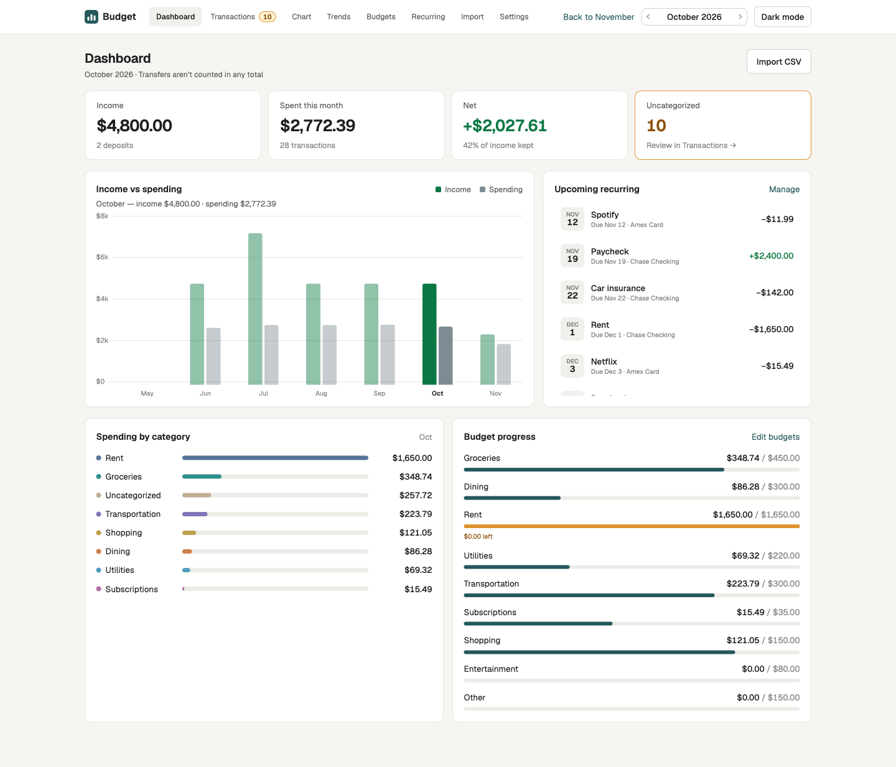
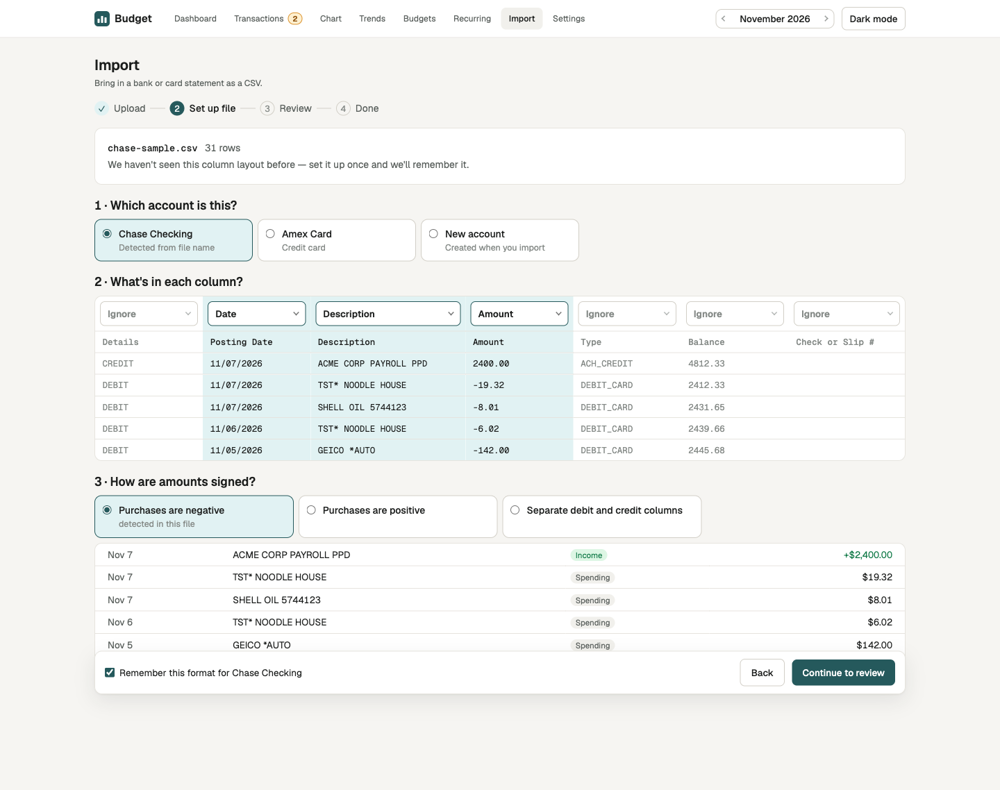
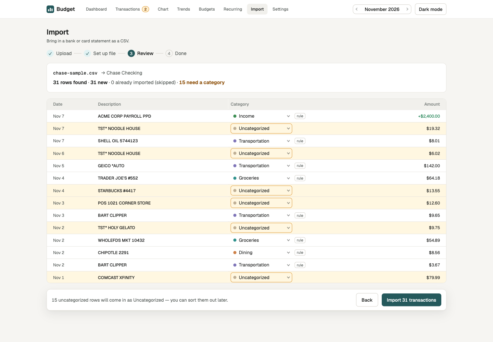

# Budget — personal finances, on your own machine

A single-user budgeting app that runs on `localhost`. You import the CSV statements your bank and card
already export. The app learns how to categorize them as you correct it and rolls everything up into
monthly budgets, a dashboard, charts and recurring bills and paychecks.

There is no cloud, no login and no bank connection. Everything lives in one SQLite file
(`data/budget.db`) that never leaves the machine and is ignored by git. An Express API serves a React + Vite
frontend.



*All screenshots use fake data from the app's built-in sample generator: made-up accounts, merchants and
amounts. No real financial data appears in this repo.*

## Features

- **CSV import.** Map a file's date, description and amount columns and its sign convention once. The
  mapping is saved per account, so the next statement from that bank skips setup. A live preview shows
  how rows will parse before anything is saved. Any import can be undone.
- **Learned categorization.** When you recategorize a transaction, the app offers a rule for that merchant
  ("STARBUCKS → Coffee") and shows how many other uncategorized transactions it would fix. New imports apply
  your rules automatically. No AI is involved, only substring rules you can see and edit.
- **Transactions.** Search one month or all time, filter by account, category or day, and categorize in
  bulk or from the keyboard (`j`/`k` to move, `x` to select, `1`–`9` to pick a category). You can add notes,
  custom descriptions, edited dates and receipts (image or PDF), and split one charge across categories.
- **Budgets.** Monthly budgets per category plus an "Other" bucket for everything without its own. Fixed
  costs such as rent are reported apart from flexible spending, so they don't swamp "% used". One click
  copies last month's budgets.
- **Dashboard.** Income, spending and net for the month, 7 months of income vs. spending, spending by
  category, budget progress, and recurring items that are expected but not imported yet.
- **Chart.** The month's running net, day by day. Click any day to see its transactions.
- **Trends.** 12 months of spending, overall or for one category, plus year-to-date totals.
- **Recurring.** Track rent, paychecks and subscriptions. Imports mark them received, and suggestions are
  detected from your history.
- **Backups.** One-click download, plus an automatic snapshot before every import and undo.
- Light and dark themes, and `←`/`→` changes the month on any page.





## Engineering notes

**Re-importing a statement never creates duplicates.** Bank exports overlap: last month's statement and
this month's share a week. A row counts as a duplicate when it matches on account, date, amount in cents
and description (uppercased, whitespace collapsed). The match is *count-based*, so two genuine $4.50
coffees on the same day both import the first time, and re-importing that file skips exactly two. The
match is scoped per account, so a card payment that shows up in both checking and the card isn't dropped.

**One parser, run twice.** The CSV parser, merchant-key logic, totals and recurring math are pure
TypeScript in `shared/`, used by both the browser and the server. The browser runs it for the live preview
while you set up a file. At commit the server ignores the rows the browser computed. It re-parses the raw
file with the chosen format, re-checks duplicates against the database, and writes everything in one
transaction. A stale preview can't put bad data in the database.

**Money is integer cents, everywhere.** Amounts are parsed straight to cents and never pass through a
float. The parser caps amounts at 12 integer digits, so every value stays a safe JavaScript integer.

**Local-only, and hardened anyway.** The API binds `127.0.0.1` only. That doesn't stop a web page in
another tab from sending a form POST to `localhost`, and a body-less cross-origin request could once have
wiped the database. So every non-GET request must be `Content-Type: application/json` from a loopback
`Origin`, which a plain HTML form can't send. Fonts are self-hosted, so the app makes no third-party
requests.

**Split transactions without breaking imports.** Splitting a charge turns the original row into a hidden
parent and adds child rows with their own categories that sum to it exactly. Duplicate detection keys on
the parent, so re-importing the statement still recognizes the split charge. Every list, total, budget
and chart filters parents out through one shared SQL predicate (`VISIBLE` in `server/db.ts`), so no
query can count a split charge twice.

**Backups that are actually consistent.** The database runs in WAL mode, so copying the file can capture
a half-written state. Automatic snapshots use `VACUUM INTO` (newest 10 kept in `data/backups/`), and the
download uses `db.serialize()`. Both give a complete, consistent copy.

## Quick start

Needs Node 20.

```sh
npm install
npm run dev        # API on 127.0.0.1:5174, app on http://localhost:5173
```

Open <http://localhost:5173>. If you don't have a statement handy, go to **Import → Use a sample Chase
export** to load a generated one.

| Command | What it does |
| --- | --- |
| `npm run dev` | API + Vite dev server (`/api` is proxied). Use this to run the app. |
| `npm run dev:isolated` | Same app on ports 5184/5183 with a throwaway DB (`$TMPDIR/budget-qa.db`) |
| `npm test` | Vitest suite (shared logic + API tests against an in-memory DB) |
| `npm run typecheck` | TypeScript check |
| `npm run build` | Vite build + typecheck |

Set `BUDGET_DB=<path>` to point the app at a different database file. To restore a backup, stop the app
and swap the file in.

## Where the data comes from

| Source | Used for | Notes |
|---|---|---|
| CSV exports from your bank or card | Every transaction | Uploaded in the app. The column mapping is saved per account. Fixtures in `test/fixtures/` are synthetic. |

That is the only input. The app calls no external APIs, sends no telemetry and has no sync. Real
statements (`*.csv`) and the database are git-ignored.

## Project layout

```
server/          Express API (app.ts), schema + migrations (db.ts), import, recurring, backup, validators
web/src/         React app: shell, shared UI primitives (ui.tsx), helpers (lib.ts)
web/src/pages/   Dashboard, Transactions, Chart, Trends, Budgets, Recurring, Import, Settings
shared/          API types + pure logic both sides run: csv.ts, merchant.ts, totals.ts, recurring.ts
test/            CSV fixtures and the API test helper
design/          the Claude Design prototype the UI was built from
specs/           product spec (budget-v1.md)
docs/            API reference, design mapping, decisions log
```

For more detail:

- [`specs/budget-v1.md`](specs/budget-v1.md): every screen, rule and edge case.
- [`docs/api.md`](docs/api.md): the `/api/*` endpoints.
- [`docs/design.md`](docs/design.md): how the prototype maps to the code.
- [`docs/decisions.md`](docs/decisions.md): why things are the way they are.

## How this was built

I set the product direction and made the calls: CSV import only (bank sync and PDF parsing were
considered and declined), transparent merchant rules instead of an LLM, local-only storage in SQLite, and
integer cents for money. Those decisions are recorded with their reasoning in
[`docs/decisions.md`](docs/decisions.md).

The implementation was built with Claude Code, using a team of specialist agents (requirements,
exploration, backend, frontend, QA and a security auditor) coordinated through [`CLAUDE.md`](CLAUDE.md).
Each slice passed a QA and security gate before it shipped. The UI started as a high-fidelity prototype
in Claude Design, saved in `design/`, and was rebuilt in the app's own stack.

## License

[MIT](LICENSE)
